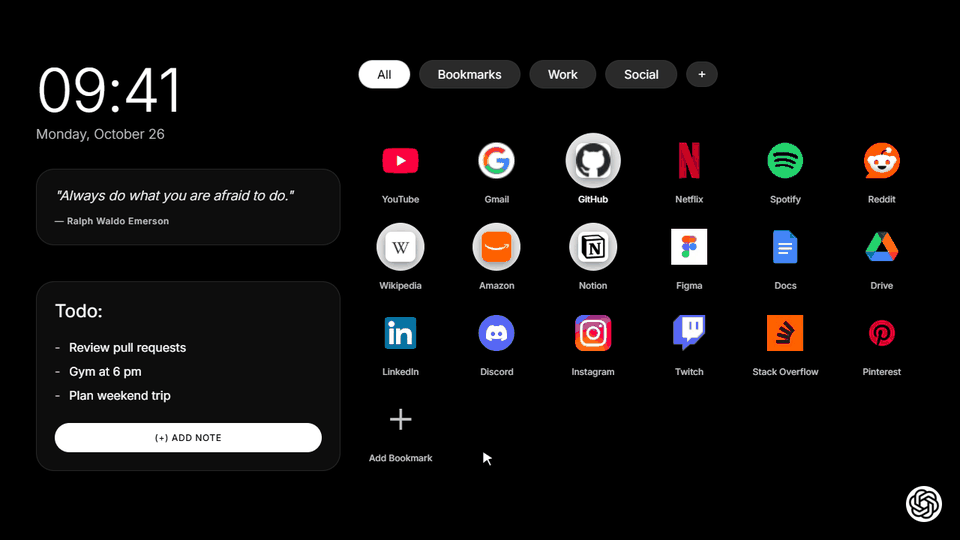
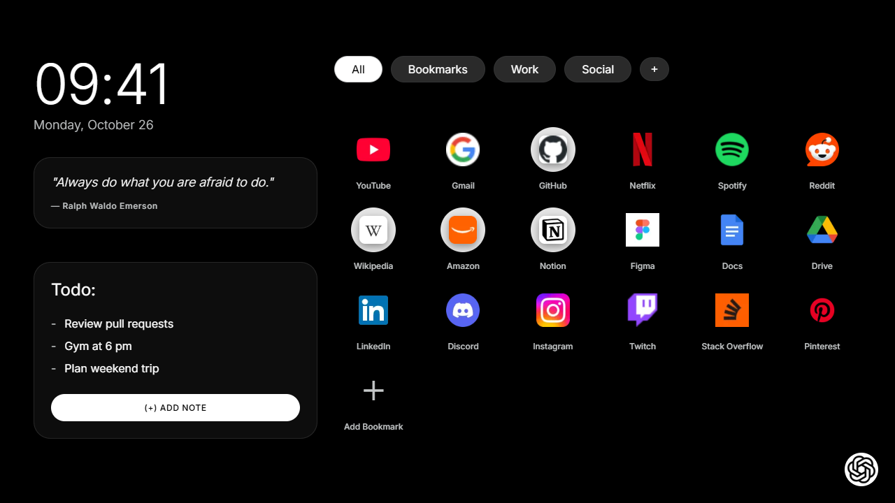
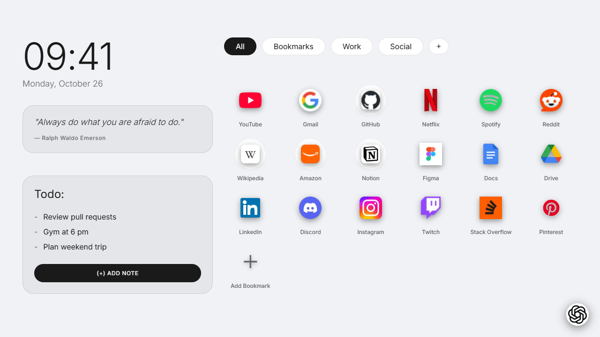
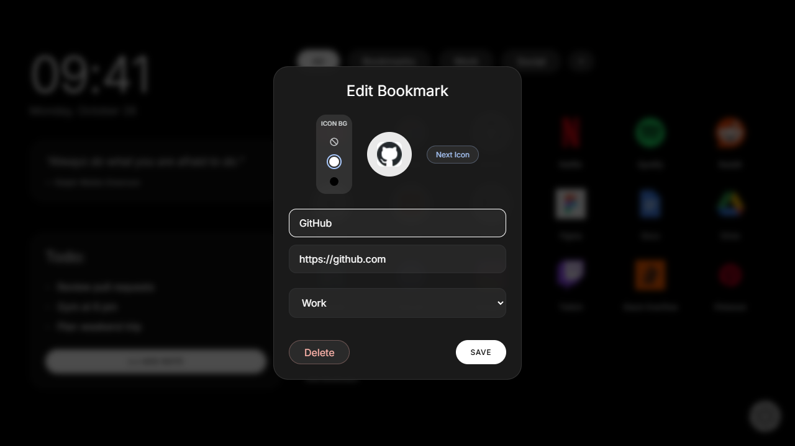
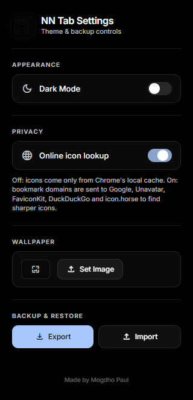

<p align="center">
  
</p>

<h1 align="center">NN Tab</h1>

<p align="center">
  <strong>A sleek, minimalist New Tab dashboard for Google Chrome.</strong><br/>
  Plain HTML, CSS and JavaScript — no frameworks, no build step, no tracking.
</p>

<p align="center">
  
  
  
  
</p>

<p align="center">
  
</p>

---

## 📸 Screenshots

<table>
  <tr>
    <td align="center"><br/><sub><b>Dark mode</b></sub></td>
    <td align="center"><br/><sub><b>Light mode</b></sub></td>
  </tr>
  <tr>
    <td align="center"><br/><sub><b>Bookmark editor</b> — live icon preview, icon background, category</sub></td>
    <td align="center"><br/><sub><b>Settings popup</b> — theme, icon privacy, wallpaper, backup</sub></td>
  </tr>
</table>

> Screenshots show bookmarks added by hand with online icon lookup turned on. A fresh install starts with an empty grid.

---

## ✨ Features

### 🕐 Clock & Date
A large digital clock with the full date (weekday, month, day). It updates at the start of every minute.

### 💬 Editable Quote
A glass card with a motivational quote. **Right-click** it to set your own quote and author.

### 📝 Todo / Notes
Click **Add Note**, type, and press **Enter** (or click away) to save. **Escape** cancels. Click the check mark to finish a note.

### 🔖 Bookmarks Grid
- **Add, edit and delete** bookmarks in a modal. **Right-click** a tile to edit it.
- **Live icon preview** while you type the URL.
- **Next Icon** cycles through the available icon sources.
- **Icon background**: none, white or black, for logos that need contrast.
- **Drag and drop** to reorder.
- Up to 24 bookmarks per category.

### 🗂️ Categories
- Defaults: All, Bookmarks, Work, Social.
- Click **+** to add a category; **right-click** one to rename or delete it.
- Deleting a category moves its bookmarks to another category, so nothing disappears. The last category can't be deleted.
- The last selected category is remembered.

### 🎨 Settings popup
Click the NN Tab icon in the Chrome toolbar to:
- Switch between **dark and light mode**.
- Set or remove a **wallpaper** (resized to 1920px wide and stored locally).
- Turn **online icon lookup** on or off (see Privacy below).
- **Export** your data to a JSON file and **import** it again. Imports are checked first: invalid files are rejected, invalid parts are skipped, and nothing is replaced until you confirm.

### 🤖 ChatGPT button
The floating button in the bottom-right corner opens ChatGPT in a small popup window. Click it again, or click anywhere on the dashboard, to close it.

---

## 🔒 Privacy

Everything you create (bookmarks, categories, notes, quote, wallpaper, settings) is stored **only on your device** in `chrome.storage.local`. There are no accounts, no sync, no analytics, and the extension does not open any pages on install or uninstall. Fonts are bundled with the extension, so opening a new tab makes no network requests.

### Bookmark icons
- **Default: local only.** Icons come from Chrome's own favicon cache via the `favicon` permission. No data leaves your machine. A site shows a placeholder until you've visited it at least once in Chrome; after that its icon appears on the next new tab.
- **Optional: online icon lookup.** Turn it on in the settings popup, or click **Next Icon** in the bookmark modal. Chrome asks for your permission first. When it's on, the bookmark's domain is sent to these services to find a sharper icon:

  | Service | Used for |
  |---|---|
  | Google (`t1.gstatic.com`, `www.gstatic.com`) | Favicons and Google product icons |
  | Unavatar | Logo aggregator |
  | FaviconKit | High-res favicons |
  | DuckDuckGo | Favicons |
  | icon.horse | Favicons |
  | The bookmarked site itself | `apple-touch-icon.png` / `favicon.ico` (only for sites you allowed from **Next Icon**) |

  Requests are sent without cookies or a referrer, and each one times out after 5 seconds. Found icons are resized to 64×64 WebP and saved, so each icon is fetched only once. Turning the setting off removes the permission; icons already saved are kept.

### Permissions

| Permission | Why |
|---|---|
| `storage` | Save your bookmarks, notes and settings locally. |
| `unlimitedStorage` | Room for saved icons and a wallpaper image. |
| `favicon` | Read icons from Chrome's local favicon cache. |
| Optional host access | Only requested if you turn on online icon lookup. It's limited to the icon services above, plus individual sites you approve. |

---

## 🚀 Installation

The extension isn't on the Chrome Web Store yet. To install it manually:

1. Download this repository: use **Code → Download ZIP** on GitHub, or a ZIP from the [Releases page](https://github.com/mogdho/NN-tab/releases), and extract it. Or clone it:
   ```bash
   git clone https://github.com/mogdho/NN-tab.git
   ```
2. Open `chrome://extensions/` in Chrome.
3. Turn on **Developer mode** (top-right).
4. Click **Load unpacked** and select the folder that contains `manifest.json`.
5. Open a new tab (`Ctrl + T`).

**Updating from 1.2x:** existing data is kept. Older versions had permanent access to all websites; 1.3 drops that. Turn on online icon lookup in the settings popup if you want the old icon behaviour.

---

## 📂 Project Structure

```text
NN-tab/
├── css/
│   ├── fonts.css          # Bundled Inter + Material Symbols font faces
│   ├── variables.css      # Design tokens (colors, spacing, radii) and light mode
│   ├── base.css           # Global resets and body styles
│   ├── layout.css         # Two-column layout
│   └── components.css     # Cards, modals, widgets, buttons, inputs
├── fonts/                 # Inter (OFL 1.1) and a Material Symbols subset (Apache 2.0)
├── images/                # Bundled images (ChatGPT button icon)
├── docs/                  # README demo GIF and screenshots (not used by the extension)
├── js/
│   ├── main.js            # Entry point: theme, wallpaper, ChatGPT button, starts modules
│   ├── storage.js         # chrome.storage wrapper with a localStorage fallback
│   ├── icons.js           # Icon lookup: local favicon cache + optional online sources
│   ├── shortcuts.js       # Bookmarks grid, modal and drag-and-drop
│   ├── tabs.js            # Categories
│   ├── todo.js            # Notes
│   ├── quotes.js          # Quote widget
│   ├── clock.js           # Clock and date
│   ├── toast.js           # Small notification messages
│   └── backup.js          # Settings popup: theme, wallpaper, icon privacy, import/export
├── index.html             # New tab page
├── backup.html            # Settings popup (toolbar icon)
├── manifest.json          # Chrome Manifest V3 config
└── tab.png                # Extension icon
```

### Adding a new icon glyph
`fonts/material-symbols-outlined.woff2` contains only the icons the UI uses. To add one, add its name to the `icon_names` list below (keep the list alphabetical), open the URL in Chrome, and download the `woff2` file it links to, replacing the existing file:

```
https://fonts.googleapis.com/css2?family=Material+Symbols+Outlined:opsz,wght,FILL,GRAD@20..48,100..700,0..1,-50..200&icon_names=add,block,check,dark_mode,delete,download,language,light_mode,public,smart_toy,sync,upload,wallpaper&display=block
```

---

## ⌨️ Usage Tips

| Action | How |
|---|---|
| Add a bookmark | Click the **+** tile in the grid |
| Edit / delete a bookmark | **Right-click** the tile |
| Try another icon | **Next Icon** in the bookmark modal |
| Reorder bookmarks | Drag and drop tiles |
| Add a category | Click **+** in the tab bar |
| Rename / delete a category | **Right-click** the tab |
| Edit the quote | **Right-click** the quote card |
| Close any dialog | **Escape** or click outside it |
| Theme, wallpaper, backup, icon privacy | Click the NN Tab toolbar icon |

---

## 🤝 Contributing

Issues and pull requests are welcome at [github.com/mogdho/NN-tab](https://github.com/mogdho/NN-tab/issues).

## 📝 License

[MIT](LICENSE). Bundled fonts keep their own licenses: Inter (SIL Open Font License 1.1) and Material Symbols (Apache License 2.0).
